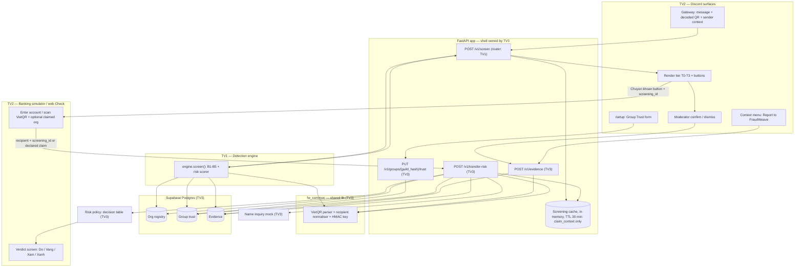

# FraudWeave — Integration Contract v0.1 (draft)

Nov 25, 2026 · @Rykanny · Owner: TV3 (Backend & Fraud Intelligence)

## 1. Review: is the current pipeline and split sound?

Mostly yes: ownership by layer (TV1 = detection, TV2 = surfaces, TV3 = data + API) is clean, and evidence only enters the store after a mod confirm, which matches our privacy design (Lane B). But six issues must be fixed before we freeze the contract. Issue 1 is the most important, because it decides whether SafeTransfer has any value beyond what MoMo already has.

| \# | Issue | Why it matters | Fix (in this contract) |
| --- | --- | --- | --- |
| 1 | SafeTransfer only reads the Evidence Store. No edge from Registry / Group Trust / Name Inquiry to SafeTransfer, and no claim context in /v1/transfer-risk. | Without the claim, SafeTransfer is a blacklist lookup. MoMo's AI recipient warning and SIMO already do that (finding F1). Our value is the claim–payee mismatch (C2, C3). The PNG even shows "Xanh = khớp tài khoản đã đăng ký", but the Mermaid has no path for it. | transfer-risk takes optional claim_context (from a Discord screening_id or declared by the user on the form) and reads Registry + Group Trust + Name Inquiry mock. C2/C3/C5 are computed inside SafeTransfer. |
| 2 | Indicator extraction (B2, TV1) and the VietQR parser / normaliser (TV3) are two places that turn text into a recipient. | If they normalise differently, recipient_key values never match, and evidence written by Guardian is never found by SafeTransfer. Silent failure. | One shared package fw_common (TV3 owns). TV1 imports it; nobody re-implements. Golden fixtures test it (§8). |
| 3 | TV3 is a bottleneck: 13 modules + E2E lead, and /v1/screen (Guardian's hot path) runs through TV3's code. TV1 has 5 modules, TV2 has 7. | If TV3 slips, both features stop. Data curation (50-org registry, public scam evidence) is slow manual work hidden inside "backend". | One FastAPI app, but routers owned by feature: TV1 owns routers/screen.py + engine; TV3 owns the app shell, DB, transfer, evidence, registry. Data collection moves to TV1 (already collects public scam data); TV3 owns schema + ingestion. See §3. |
| 4 | Modules with no owner: Name Inquiry mock, /setup Group Trust command, "Report" context menu → ingestion, screening cache, HMAC key management, SafeTransfer eval set, demo seed scenarios, audit log. | Unowned work is done last or never, usually the night before the demo. | Assigned in §3. |
| 5 | No rule against report poisoning. Any user can "Báo cáo" a legit account (e.g. a class fund). | If one unverified report can make a verdict Đỏ, the system becomes a griefing tool, and we lose trust in the demo Q&A. | Đỏ needs verified evidence or a hard contradiction. Unverified reports cap at Vàng. Simulation data counts only in mode=demo. See §6. |
| 6 | Numbers disagree: PNG says Transfer API ≤ 300 ms, plan v3 says engine p95 ≤ 150 ms. PNG has no SafeTransfer metric. | Judges ask about metrics; inconsistent numbers look careless. | One budget table in §7. SafeTransfer target: ≥ 95% correct verdicts, 0 wrong Xanh on the golden + eval set. |

Smaller points: the Mermaid draws TV2's Banking Simulator → transfer-risk but not the screening_id it must carry; and the Detection Result → Core Backend loop is drawn as two long edges that look like a cycle. The revised diagram in §2 fixes both.

## 2. Revised end-to-end pipeline

The change: SafeTransfer now reads the same Registry and Group Trust as the Claim-Check engine, receives the claim context from Discord through a short-lived screening_id, and every component normalises recipients through one shared library.



Reading order for each feature:

1.  **Guardian:** Discord message → /v1/screen → engine.screen() (reads registry, trust, evidence) → tier + reasons → claim context cached 30 min under screening_id → TV2 renders warning → a mod confirm writes evidence through /v1/evidence.

2.  **SafeTransfer:** user enters account / scans QR (from the warning button, or directly on the web) → /v1/transfer-risk → normalise → look up claim context, registry, trust, evidence, name inquiry → decision table → verdict + evidence JSON → TV2 renders it.

3.  **Shared:** all writes into Evidence go through one ingestion endpoint; all recipient keys come from fw_common.

## 3. Revised ownership and task split

Keep the three roles, but move data curation from TV3 to TV1, give TV2 the forms that feed TV3's stores, and assign every orphan module. "Owner" = writes it and answers for it; "Consumer" = must call it exactly as this contract says.

| Module | Owner | Consumer(s) | Change vs current split |
| --- | --- | --- | --- |
| Training data, PhoBERT fine-tune, ONNX export | TV1 | — | none |
| engine.screen() (B1–B5 + Guardian risk scorer) as a Python package | TV1 | TV3 app | Delivered as an importable package, not a separate service |
| routers/screen.py (POST /v1/screen) | TV1 | TV2 bot | **Moved from TV3.** TV1 owns its own endpoint inside TV3's app shell |
| Raw data collection: 50-org registry content, public scam warnings, PhishVN/feeds | TV1 | TV3 ingestion | **Moved from TV3.** TV1 already collects public scam data for training; reuse the same effort. TV3 defines the CSV/JSON template |
| Guardian eval (precision/recall, 0 public false alarms) | TV1 | — | none |
| Discord bot gateway, QR image decoding, tier rendering, mod review UI | TV2 | — | none |
| /setup Group Trust form + "Report to FraudWeave" context menu | TV2 | calls TV3 endpoints | **New owner** (was unassigned) |
| "Chuyển khoản" button carrying screening_id | TV2 | TV3 | Clarified |
| Banking simulator / web FraudWeave Check (form + verdict screen) | TV2 | TV3 | Form adds an optional "Người nhận tự xưng là…" (claimed org) field |
| FastAPI app shell, auth (API keys), config, logging, health | TV3 | all | none |
| fw_common: VietQR parser, recipient normaliser, HMAC key, indicator canonicalisation | TV3 | TV1, TV2 (types only) | **Now explicitly shared**; TV1 must import it |
| Supabase schema + migrations: registry, group trust, evidence | TV3 | TV1 (read) | none |
| POST /v1/evidence ingestion: validate, dedupe, status lifecycle, TTL | TV3 | TV1 (bulk load), TV2 (mod confirm, report) | none |
| Screening cache (screening_id → claim_context, 30 min, in memory) | TV3 | TV1 writes, SafeTransfer reads | **New** |
| POST /v1/transfer-risk + decision table + name-inquiry mock | TV3 | TV2 | Name inquiry now owned |
| SafeTransfer eval set (≥ 150 labelled transfer cases) + golden fixtures | TV3 | all (contract tests) | **New** |
| Demo seed scenarios (registry rows, group, scam accounts, messages) | TV3 leads, TV1 + TV2 add | demo | **New** |
| E2E integration + demo script | TV3 leads | all | none |

Rough load after the change: TV1 ≈ 7 items (heavy ML + data), TV2 ≈ 7 (UI-heavy), TV3 ≈ 9 + integration lead. Still the most for TV3, but none of it is manual data collection any more.

## 4. Shared data types

The Pydantic models in fw_common/contracts.py are the single source of truth; OpenAPI is generated from them, never written by hand. All enum values are English snake_case; TV2 maps them to Vietnamese labels.

### 4.1 Recipient normalisation rules (fw_common.normalize)

1.  **Account number:** remove spaces, ., -; must be 6–19 digits after cleaning; keep leading zeros. Otherwise invalid_recipient.

2.  **Bank:** resolve to a 6-digit NAPAS BIN. Accept a BIN, a short name or an alias ("VCB", "Vietcombank") via bank_aliases.json in fw_common. Unknown → unknown_bank.

3.  **VietQR payload:** parse EMVCo TLV; check the CRC (tag 63); read BIN + account from tag 38 (VietQR/NAPAS GUID), service type (account vs card), amount (tag 54) and memo (tag 62). Bad CRC → invalid_qr. TV2 decodes the image to a string; TV3 parses the string.

4.  **Recipient key:** recipient_key = "rk\_" + hex(HMAC_SHA256(FW_HMAC_KEY, f"acct:{bin}:{account_no}"))\[:32\]. The raw number is never stored or logged; display uses account_masked = last 4 digits.

5.  **Other indicators** (Guardian only in MVP): phone → E.164 +84…; domain → lowercase registrable domain, IDNA-encoded; URL → scheme + host + path, no query string.

### 4.2 Core models

```python
class RecipientInput(BaseModel):          # what clients send
    bank: str | None = None               # BIN, short name or alias
    account_no: str | None = None
    vietqr_payload: str | None = None     # raw decoded QR string
    # rule: either vietqr_payload, or bank + account_no

class NormalizedRecipient(BaseModel):     # what the server returns
    bank_bin: str                         # "970436"
    bank_short: str                       # "VCB"
    account_masked: str                   # "******6789"
    recipient_key: str                    # "rk_3f9a..." (32 hex)
    kind: Literal["account", "card"]
    source: Literal["manual", "vietqr"]
    qr_amount: int | None = None          # VND, only if in QR
    qr_memo: str | None = None

class Indicator(BaseModel):
    type: Literal["account", "phone", "domain", "url"]
    key: str                              # recipient_key for accounts; canonical value otherwise
    display: str                          # masked for accounts

ClaimedRole = Literal["org_staff", "bank_staff", "police", "teacher",
                      "admin", "treasurer", "org_support", "other"]

class ClaimContext(BaseModel):
    claimed_org_id: str | None = None     # registry id, if resolved
    claimed_org_raw: str | None = None    # text as written, e.g. "EVN HCMC"
    claimed_role: ClaimedRole | None = None
    guild_hash: str | None = None         # links to Group Trust
    source: Literal["discord_message", "user_declared", "transfer_memo"]
    soft_signals: list[Literal["C7", "C8", "C9"]] = []   # carried from Guardian

class Contradiction(BaseModel):
    code: Literal["C1","C2","C3","C4","C5","C6","C7","C8","C9"]
    severity: Literal["hard", "soft"]     # C1-C6 hard, C7-C9 soft
    reason_code: str                      # e.g. "payee_not_official_account"
    message_vi: str                       # template text shown to users
    evidence_ids: list[UUID] = []

ScamType = Literal["impersonation_org", "impersonation_role", "fake_fundraising",
                   "investment", "job_task", "phishing_link", "loan", "other"]

EvidenceSource = Literal["mod_confirmed", "user_report", "public_warning",
                         "curated_feed", "simulation"]
EvidenceStatus = Literal["verified", "unverified", "simulation", "retracted"]

class EvidenceRecord(BaseModel):
    evidence_id: UUID
    indicator: Indicator
    scam_type: ScamType
    source: EvidenceSource
    status: EvidenceStatus
    source_url: str | None = None         # required for public_warning
    distinct_reporters: int = 1           # hashed reporters, never IDs
    first_seen: datetime
    last_seen: datetime
    expires_at: datetime                  # TTL by status (§7)
```

Status is set by the server, never by the caller: mod_confirmed and public_warning with a source_url → verified; user_report → unverified; simulation → simulation.

## 5. API endpoints

Six endpoints cover both features. All take X-API-Key (one key per client: bot, web, simulator, loader) and an X-Request-Id; all return JSON.

| Endpoint | Owner | Caller | Purpose |
| --- | --- | --- | --- |
| POST /v1/screen | TV1 | TV2 bot | Screen one Discord message → tier, reasons, screening_id |
| POST /v1/transfer-risk | TV3 | TV2 simulator / web | Verdict for a payee before transfer |
| POST /v1/evidence | TV3 | TV2 (mod confirm, report), TV1 loader | Add or confirm evidence |
| PUT /v1/groups/{guild_hash}/trust | TV3 | TV2 /setup | Save anchors + declared fund accounts |
| GET /v1/registry/orgs?q= | TV3 | TV2 form autocomplete, TV1 engine | Look up official org data |
| GET /v1/health | TV3 | all | Liveness + model/policy versions |

### 5.1 POST /v1/transfer-risk (SafeTransfer)

```jsonc
// request
{
  "recipient": { "bank": "VCB", "account_no": "0071001234567" },
  "amount_band": "1m_10m",              // lt_1m | 1m_10m | 10m_50m | gt_50m
  "screening_id": "scr_9f2c...",        // optional, from the Discord button
  "claim_context": {                     // optional, used if no screening_id
    "claimed_org_raw": "EVN HCMC",
    "claimed_role": "org_staff",
    "source": "user_declared"
  },
  "transfer_memo": "thanh toan tien dien", // optional, rules only, not stored
  "mode": "live"                         // live | demo
}

// response 200
{
  "verdict": "red",                      // red | amber | grey | green
  "recommended_action": "cancel",        // cancel | verify_by_call | proceed
  "recipient": { "bank_bin": "970436", "bank_short": "VCB",
                 "account_masked": "*********4567", "recipient_key": "rk_...",
                 "kind": "account", "source": "manual" },
  "claim_used": { "claimed_org_id": "evn_hcmc", "source": "user_declared" },
  "name_inquiry": { "holder_name_masked": "NGUYEN V*** A",
                    "holder_type": "personal", "source": "mock" },
  "contradictions": [
    { "code": "C2", "severity": "hard", "reason_code": "payee_not_official_account",
      "message_vi": "Tài khoản này không nằm trong danh sách tài khoản chính thức của EVN HCMC.",
      "evidence_ids": [] },
    { "code": "C3", "severity": "hard", "reason_code": "personal_holder_for_org_claim",
      "message_vi": "Người nhận là cá nhân, nhưng người gửi tự xưng là tổ chức.",
      "evidence_ids": [] }
  ],
  "evidence_summary": { "verified": 0, "unverified": 1, "distinct_reporters": 1,
                        "scam_types": ["impersonation_org"], "last_seen": "2026-11-20T08:00:00Z" },
  "evidence": [ /* top 3 EvidenceRecord, display fields only */ ],
  "official_alternative": { "org_name": "EVN HCMC", "hotline": "19009000",
                            "source_url": "https://..." },
  "policy_version": "st-policy-0.1",
  "latency_ms": 42
}
```

Rules: screening_id wins over claim_context if both are sent. An expired or unknown screening_id is not an error: the server ignores it and adds the reason code screening_expired. official_alternative is filled only when a claimed org is in the registry.

### 5.2 POST /v1/screen (Guardian)

```jsonc
// request
{
  "guild_hash": "g_...", "channel_hash": "c_...",
  "message": { "text": "...", "edited": false, "qr_payloads": ["000201..."],
               "has_attachments": true },
  "sender": { "sender_hash": "s_...",          // salted, rotates; never the Discord ID
              "display_name": "Co Lan GVCN", "is_anchor": false,
              "account_age_days": 3, "joined_age_days": 0 }
}
// response 200
{
  "screening_id": "scr_9f2c...",           // null when tier = 0 and no claim
  "tier": 2,                               // 0 silent | 1 mod | 2 reply | 3 delete+reply
  "risk_score": 0.91,
  "contradictions": [ /* Contradiction[] */ ],
  "indicators": [ /* Indicator[] built with fw_common */ ],
  "claim_context": { /* ClaimContext, source = discord_message */ },
  "evidence_candidate": { "indicators": ["rk_..."], "scam_type": "impersonation_role" },
  "model_version": "phobert-b-0.3", "latency_ms": 310
}
```

The server stores claim_context + soft_signals in the screening cache; it never stores message.text.

### 5.3 POST /v1/evidence

```jsonc
// request
{ "indicator_input": { "recipient": { "vietqr_payload": "000201..." } },  // or { "phone": "..." } / { "url": "..." }
  "scam_type": "impersonation_role",
  "source": "mod_confirmed",            // caller says where it came from
  "source_url": null,
  "reporter_hash": "r_...",             // for distinct counting only
  "screening_id": "scr_9f2c..." }       // optional, links to the Guardian event
// response 201 (new) or 200 (merged into existing)
{ "evidence_id": "...", "status": "verified", "merged": false, "distinct_reporters": 1 }
```

Dedup key = (indicator.key, scam_type). A merge updates last_seen, distinct_reporters, and can only raise status (unverified → verified), except retracted, which is admin-only.

### 5.4 PUT /v1/groups/{guild_hash}/trust

```jsonc
{ "anchors": [ { "role": "teacher", "member_hash": "m_...", "display_name": "Co Lan" } ],
  "declared_fund_accounts": [ { "bank": "MB", "account_no": "..." } ],
  "payment_policy": "declared_accounts_only",  // declared_accounts_only | none
  "set_by_hash": "m_..." }
```

The server stores only recipient_key + account_masked for declared accounts.

### 5.5 Registry record (GET /v1/registry/orgs)

```jsonc
{ "org_id": "evn_hcmc", "name": "Tổng công ty Điện lực TP.HCM", "aliases": ["EVN HCMC", "EVNHCMC"],
  "domains": ["evnhcmc.vn"], "hotlines": ["19009000"],
  "official_account_keys": ["rk_..."], "never_asks": ["otp", "personal_transfer"],
  "source_url": "https://...", "verified_at": "2026-11-24" }
```

Registry values above are placeholders; real rows must come from the org's own website, with source_url.

## 6. SafeTransfer verdict policy

The verdict is a deterministic, ordered decision table: the first rule that matches wins, and every verdict lists the reason codes that fired. No ML score decides a SafeTransfer verdict in the MVP; this keeps it explainable and testable to "0 wrong Xanh".

**Inputs the policy sees**

- match_official: recipient_key is in the claimed org's official_account_keys.

- match_declared: recipient_key is in the group's declared fund accounts (needs guild_hash in the claim).

- E_verified: count of non-expired verified evidence on the key. In mode=demo, simulation evidence counts here too, and the response sets demo_data_used: true. In mode=live it is ignored.

- E_unverified: count of non-expired unverified evidence.

- Hard contradictions, computed by SafeTransfer:

  - **C2** payee_not_official_account: the claim resolves to a registry org (or to a group with payment_policy = declared_accounts_only and role teacher / treasurer / admin), and neither match is true.

  - **C3** personal_holder_for_org_claim: claimed org or role org_staff / bank_staff / police, and name inquiry says holder_type = personal.

  - **C5** confirmed_indicator: E_verified ≥ 1.

  - **C6** org_never_asks_transfer: the claimed org's never_asks includes this action (e.g. police or bank staff asking to move money to a "safe account").

- Soft signals: C7–C9 carried from Guardian via screening_id, plus pressure words in transfer_memo (rules only).

**Decision table (first match wins)**

| Order | Condition | Verdict | Action | Reason codes |
| --- | --- | --- | --- | --- |
| 0 | Recipient cannot be normalised | HTTP 422 | Re-enter | invalid_recipient, unknown_bank, invalid_qr |
| 1 | (match_official or match_declared) and E_verified ≥ 1 | amber | verify_by_call | registry_conflict (also queued for review) |
| 2 | Any hard contradiction (C2, C3, C5, C6) | red | cancel | the fired C-codes |
| 3 | match_official or match_declared | green | proceed | matches_official_account / matches_declared_account (+ unverified_reports_on_official note if E_unverified ≥ 1, queued for review) |
| 4 | E_unverified ≥ 1, or any soft signal, or the claimed org is not in the registry | amber | verify_by_call | unverified_reports, C7–C9, org_not_in_registry |
| 5 | Otherwise | grey | verify_by_call | no_data |

**Guarantees this table gives**

- **Green needs a claim.** Without a claimed org or group, rule 3 can never fire, so the best a user can get is grey. We never say "an toàn"; green text says "Khớp tài khoản chính thức của {org} (nguồn: …)".

- **Report poisoning is capped.** Unverified reports alone reach amber at most, and cannot remove green from an official account (rule 3 comes before rule 4). A griefer can, at worst, trigger a review.

- **Grey is honest.** Copy: "Chưa có dữ liệu về tài khoản này — điều này không có nghĩa là an toàn."

- **Amount does not change the verdict in the MVP.** amount_band only changes the wording of the advice (e.g. stronger text above 10M VND). Open question in §10.

The policy lives in one file, safetransfer/policy.py, with a POLICY_VERSION string returned in every response.

## 7. Errors, privacy, security, latency

One error shape, one budget table, and a short list of things that are never stored.

**Error envelope** (every non-2xx response):

```jsonc
{ "error": { "code": "invalid_recipient", "message": "Account number must be 6-19 digits", "request_id": "req_..." } }
```

| HTTP | Codes | Client behaviour |
| --- | --- | --- |
| 400 | bad_request | Bug: fix the caller |
| 401 | invalid_api_key | Config error |
| 422 | invalid_recipient, unknown_bank, invalid_qr | Ask the user to re-enter |
| 429 | rate_limited | Retry after Retry-After |
| 5xx / timeout | internal_error, engine_unavailable | **Never fall back to green.** Simulator shows a distinct "Không kiểm tra được" state; bot stays silent (tier 0) and logs it |

**Latency budgets** (server-side p95, measured on the demo machine):

| Path | Server p95 | End-to-end target | Note |
| --- | --- | --- | --- |
| POST /v1/transfer-risk | ≤ 150 ms | ≤ 300 ms in the simulator | DB lookups only, no model |
| POST /v1/screen | ≤ 800 ms | ≤ 2 s Discord message → warning | ONNX INT8 PhoBERT inside |
| POST /v1/evidence | ≤ 300 ms | — | not on a user-facing hot path |

**Privacy and security rules**

- Never stored: message text, raw account numbers, Discord user/guild IDs (only salted hashes, salt rotated per deploy), exact amounts (only amount_band), transfer_memo.

- Screening cache: in memory only, 30-minute TTL, holds claim_context + soft signals only.

- Evidence TTL: verified 180 days, unverified 30 days (extended by a new distinct report), simulation never expires but is flagged.

- FW_HMAC_KEY lives in .env / Supabase secrets, never in git. Rotating it means rebuilding every recipient_key, so we do not rotate during the contest.

- Supabase: Row Level Security on, only the backend service role can read or write; no client talks to the DB directly.

- Rate limit: 60 requests/min per API key for transfer-risk and evidence.

- Audit log: every verdict logs request_id, recipient_key, verdict, reason codes, policy_version, latency. No raw identifiers.

## 8. Golden fixtures and contract tests

These eleven cases are the contract in executable form: each becomes a JSON file in contracts/fixtures/transfer/ with request + expected verdict + expected reason codes. TV3's CI must pass all eleven; TV2 uses the same files as mock responses before the real API exists. All accounts and orgs below are synthetic seed data.

| ID | Setup (seed data) | Request | Expected |
| --- | --- | --- | --- |
| G1 | Org "EVN-demo" with official account A | A, claim EVN-demo | green, matches_official_account |
| G2 | Group "Lop 5A" declares fund account B, policy declared_accounts_only | B, claim role treasurer + guild | green, matches_declared_account |
| R1 | Account C has 1 verified evidence | C, no claim | red, C5 |
| R2 | Org "VCB-demo" in registry; account D personal holder | D, claim bank_staff of VCB-demo | red, C2 + C3 |
| R3 | Group "Lop 5A" as in G2 | account E (not B), claim teacher + guild | red, C2 |
| R4 | Org "Cong an-demo", never_asks = transfer | any account, claim police | red, C6 |
| A1 | Account F has 1 unverified report | F, no claim | amber, unverified_reports |
| A2 | No data | account G, claim "Quy ABC" (not in registry) | amber, org_not_in_registry |
| A3 | Official account A (as G1) also has 1 verified evidence | A, claim EVN-demo | amber, registry_conflict |
| Y1 | No data | account H, no claim | grey, no_data |
| E1 | — | account "12AB" | 422, invalid_recipient |

Two more fixture sets:

- contracts/fixtures/normalize/: the same recipient written 6 ways (spaces, dots, bank alias, BIN, VietQR string, QR with amount) must give one recipient_key. TV1 runs this in its own CI too, which is how we catch issue 2 in §1.

- contracts/fixtures/screen/: 5 messages with expected tier and claim_context, owned by TV1, used by TV2 as mocks.

Beyond the golden cases, TV3 builds an eval set of ≥ 150 labelled transfer cases (mixed claims, evidence states, typos in input) to report "≥ 95% correct, 0 wrong green". It is frozen with the other test sets (planned freeze 1/12).

## 9. Build order: contract first, SafeTransfer first, then integration

SafeTransfer-first is a good plan, because every dependency it has (normaliser, registry, group trust, evidence, policy) is owned by TV3. The only input from another member is the claim from Guardian, and the form's "claimed org" field replaces it until integration. The condition: the contract and a mock server must exist first, so TV1 and TV2 are not blocked while TV3 builds.

1.  **Contract freeze (25–26/11).** 30-minute team review of this doc; commit fw_common/contracts.py, the fixtures in §8, and a mock FastAPI server that returns fixture responses. TV2 builds UI against the mock from day one.

2.  **Harness scaffold (26–27/11, timebox ½–1 day).** Build the 3-level harness only after the contract is frozen, so its folder layout follows the module owners in §3. Do not let it eat into step 3.

3.  **SafeTransfer standalone (27/11–1/12).** fw_common normaliser + VietQR parser with the normalise fixtures → Supabase schema + migrations → seed 10 demo orgs (not 50 yet) → evidence ingestion → policy → /v1/transfer-risk. **Gate G1 (29/11):** G1, R1, Y1, E1 pass against the real DB.

4.  **Integration (1–5/12).** TV2 switches the simulator from mock to real; TV1 imports fw_common and bulk-loads public evidence; wire screening_id (screen → cache → button → transfer-risk); freeze the eval sets on 1/12. **Gate G2 (5/12):** Discord message → warning → "Chuyển khoản" → red verdict, end to end.

5.  **Hardening (5–9/12).** Latency checks against §7, eval report (≥ 95% correct, 0 wrong green), registry to 50 orgs, demo script. **Gate G3 (9/12):** demo-ready. TechDay 11/12.

Main risk: integration bugs show up late. Two things lower it: fixtures double as mocks (everyone codes against the same JSON), and the screening_id path is wired by 3/12, not on the last day.

## 10. Change process and open questions

After the freeze, this contract changes only by a PR to contracts/ that all three members approve.

- **Additive changes** (new optional field, new reason code, new enum value at the end): one approval from each consumer is enough; no version bump.

- **Breaking changes** (rename, remove, change type or meaning): must be agreed in a team call, bump contract_version, update fixtures in the same PR.

- **Reason codes and message_vi templates** live in fw_common/reasons.py, so TV1 and TV3 share wording and TV2 never hard-codes text.

**Open questions to settle in the freeze meeting**

- [ ] Should amount_band ever change the verdict (e.g. grey → amber above 50M VND), or only the wording?

- [ ] Is a group's declared_accounts_only mismatch strong enough to be hard (red), or should it be soft (amber) when the claimed role is not an anchor?

- [ ] Who may retract evidence in the demo: TV3 admin only, or also server mods?

- [ ] Does TV1's engine read Postgres directly through TV3's repository functions, or through a small in-process cache loaded at start-up (faster, but stale)?

- [ ] One FastAPI app for both features (proposed), or two processes? One app is simpler to deploy and demo.

- [ ] Exact source and sign-off for the 50-org registry: who checks each source_url?
