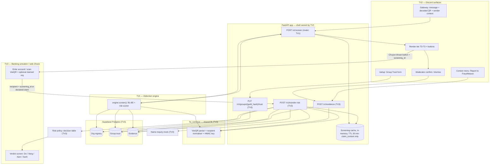

# FraudWeave — Revised end-to-end pipeline (v0.1)

> Nguồn: Contract v0.1, mục 2. Đây là bản **thay thế** Mermaid cũ (bản có "TV3 — Core Backend" chứa `/v1/screen`).
> Cập nhật 25/11/2026: nếu brief §5 (QR do TV3 làm) thay đổi gì ở sơ đồ này thì ghi chú bên dưới, không sửa lặng lẽ.

## Cách đọc

1. **Guardian:** Discord message → `/v1/screen` → `engine.screen()` (đọc registry, trust, evidence) → tier + reasons → claim context cache 30 phút dưới `screening_id` → TV2 hiển thị cảnh báo → mod confirm ghi evidence qua `/v1/evidence`.
2. **SafeTransfer:** người dùng nhập STK / quét QR (từ nút trong cảnh báo hoặc trực tiếp trên web) → `/v1/transfer-risk` → normalise → tra claim context, registry, trust, evidence, name inquiry → decision table → verdict + evidence JSON → TV2 (hoặc trang web tối giản của TV3) hiển thị.
3. **Dùng chung:** mọi ghi vào Evidence đi qua một endpoint ingestion; mọi `recipient_key` đến từ `fw_common`.

## Ghi chú cập nhật sau phân công mới (brief §5)

- VietQR **decode ảnh / parse / encode** do TV3 làm trong `fw_common` và có thêm `POST /v1/qr/decode`; TV2 gửi ảnh (hoặc dùng lại endpoint này) thay vì tự decode ở frontend. Sơ đồ trên chưa vẽ endpoint này.
- TV3 có trang web tối giản "SafeTransfer Check" để demo độc lập; nó đóng vai `FORM` + `VERD` cho đến khi tích hợp với banking simulator của TV2.
- Các mũi tên liên quan Discord (`GW`, `SETUP`, `RPT`, `WARN`, `MOD`, `screening_id`) là PENDING-NEED-CONFIRM-CONTRACT (K06–K10).
